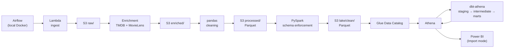

# Movie Analytics on AWS

A serverless AWS migration of my data engineering internship capstone,
[movie-analytics-capstone](https://github.com/ronliwag/movie-analytics-capstone).

The original pipeline (pandas → PySpark → dbt → Power BI, orchestrated by
Airflow) ran entirely on my laptop against PostgreSQL. This project moves it
to an **S3 + AWS Glue Data Catalog + Amazon Athena lakehouse**. The goal is to
cost about **$0/month when idle** while keeping the same tested models,
data-quality rules and dashboard.

> **Status: in progress.** See the [roadmap](#roadmap) for what's done and
> what's next. The capstone repo is the frozen, as-submitted version.

---

## Architecture



| Layer | Tool | Runs on | Output |
|---|---|---|---|
| Ingestion | AWS Lambda | AWS | Raw files in `s3://…/raw/` |
| Enrichment | Python (TMDB API, MovieLens) | Local, via Airflow | `s3://…/enriched/` |
| Cleaning | pandas | Local, via Airflow | Parquet in `s3://…/processed/` |
| Schema enforcement | PySpark | Local (optionally AWS Glue) | Parquet in `s3://…/lake/clean/` |
| Catalog + query | Glue Data Catalog + Athena | AWS (serverless) | Queryable tables |
| Modelling | dbt (`dbt-athena`) | Local, via Airflow | Star schema: fact, dimensions, bridges |
| BI | Power BI Desktop | Local | Global Scouting Map dashboard |
| Orchestration | Apache Airflow | Local Docker | Scheduled, retried, alerting DAGs |

## What changes from the capstone

| | Capstone (local) | This project (AWS) |
|---|---|---|
| Storage | Local `data/` folder | Amazon S3 data lake (raw / enriched / processed / lake) |
| Warehouse | PostgreSQL | Glue Data Catalog + Athena (serverless, pay per query) |
| pandas → Spark handoff | CSV | Parquet (removes the type and quoting workarounds) |
| Spark output | JDBC write to Postgres | Parquet on S3 |
| dbt adapter | `dbt-postgres` | `dbt-athena`, with dispatch macros so the project builds on both |
| Alerts | Log only | SNS email on task failure |
| Secrets | `.env` file | AWS SSM Parameter Store |
| Cost when idle | n/a (laptop) | About $0 (no always-on resources) |

## Business angle: Global Scouting Map

Which country and original-language markets produce consistently well-rated
films that haven't yet gained international distribution reach, and where
should content acquisition scout next? See
[docs/BUSINESS_ANGLE.md](docs/BUSINESS_ANGLE.md) and
[docs/DATA_MODEL.md](docs/DATA_MODEL.md).

## Data

Source files (from the internship program), plus enrichment:

| File | Contents | Known issues handled |
|---|---|---|
| `movies_main.csv` | Core movie records (~45K) | Duplicates, 3 mixed date formats, corrupt rows, `0` used for "unknown" |
| `ratings.json` | Rating summaries | Nested JSON, ~20% coverage, `NaN` std dev |
| `movie_extended.csv` | Genres, companies, countries, languages | Comma-packed multi-value cells, Python-repr lists |

Enrichment with the TMDB API and MovieLens raises ratings coverage from 20%
to 95% and doubles budget/revenue coverage. See
[scripts/enrichment/RESULTS.md](scripts/enrichment/RESULTS.md). Raw and
processed data are gitignored and live in S3.

## Roadmap

| # | Phase | Status |
|---|---|---|
| 0 | Account setup, IAM, cost guardrails | ✅ Done |
| 1 | S3 data lake + upload data | ⬜ Next |
| 2 | pandas cleaning writes Parquet | ⬜ |
| 3 | PySpark → S3 lake + Glue Catalog tables | ⬜ |
| 4 | dbt on Athena (multi-adapter) | ⬜ |
| 5 | Power BI on Athena | ⬜ |
| 6 | Lambda ingest + enrichment on S3 | ⬜ |
| 7 | Airflow orchestrates AWS + SNS alerts + dbt docs site | ⬜ |
| 8 | *Optional:* PySpark as an AWS Glue job | ⬜ |
| 9 | *Optional:* fully serverless orchestration (Step Functions + CodeBuild) | ⬜ |
| 10 | *Optional:* infrastructure as code | ⬜ |

## Cost and security guardrails

- AWS Budgets: a zero-spend alert and a $1/month budget; Cost Anomaly Detection on
- Root user protected with MFA and not used day to day
- Least-privilege IAM: the pipeline's credentials can only touch this
  project's bucket, Athena workgroup and Glue databases
- Athena workgroup with a per-query scan limit
- No always-on resources (no RDS, NAT Gateway, MWAA or EMR)

## Repository structure

```
scripts/
  enrichment/    TMDB + MovieLens gap-filling and validation
  pandas/        OOP data model + cleaning
  pyspark/       Schema-enforced batch processing
  sql/           Standalone schema design + window-function queries
dbt_project/     staging → intermediate → marts (+ tests, docs, seeds)
airflow/         DAGs + Docker Compose setup
powerbi/         Dashboard
docs/            Business angle, data model
notebooks/       Exploration
```

## Local setup

Prerequisites: WSL/Linux, Python 3.11+, Docker (for Airflow), and the AWS CLI
configured with a least-privilege profile.

```bash
python -m venv venv
source venv/bin/activate
pip install -r requirements.txt

aws configure --profile movie-pipeline   # region: ap-southeast-1
export AWS_PROFILE=movie-pipeline
```

Airflow runs via Docker Compose; see [airflow/README.md](airflow/README.md).

## Acknowledgements

Dataset and original project brief from my data engineering internship
program. The original, as-submitted work is in
[movie-analytics-capstone](https://github.com/ronliwag/movie-analytics-capstone).
